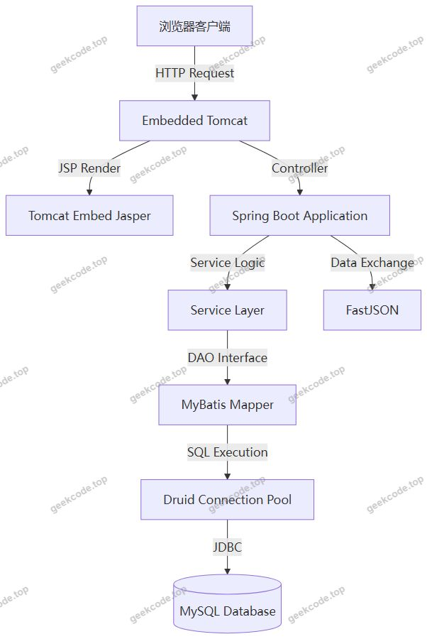
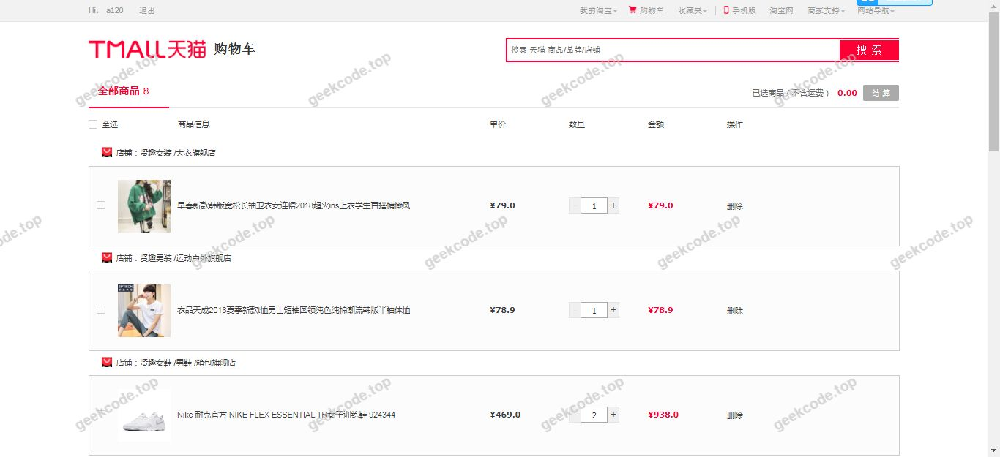
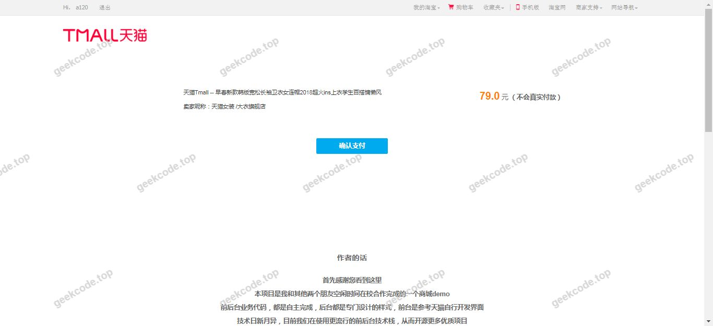
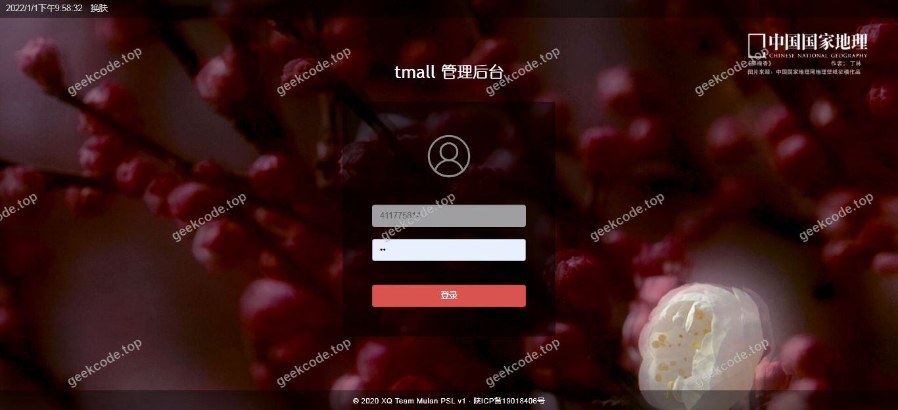
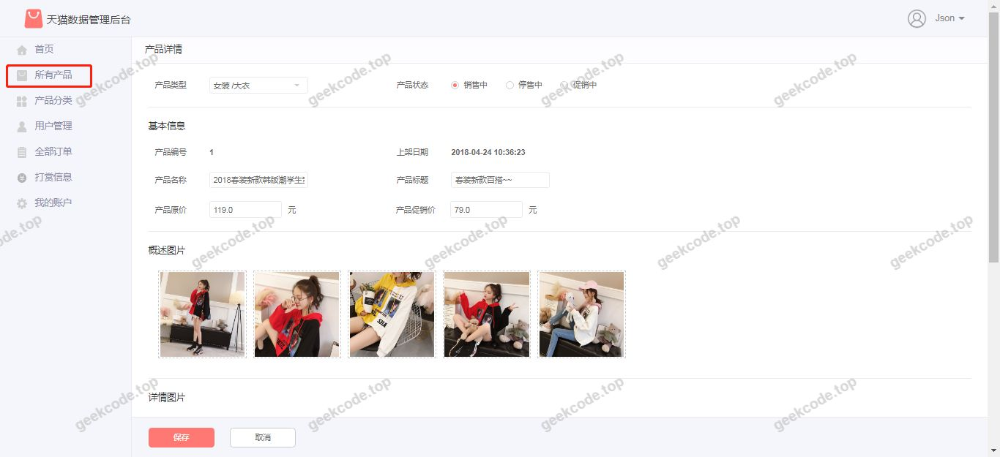
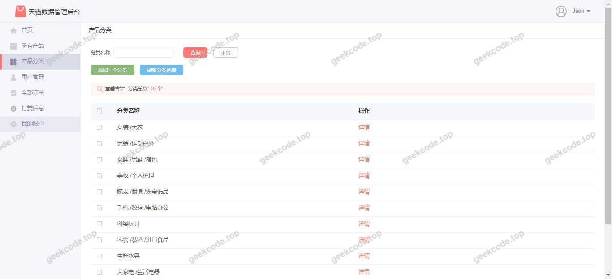
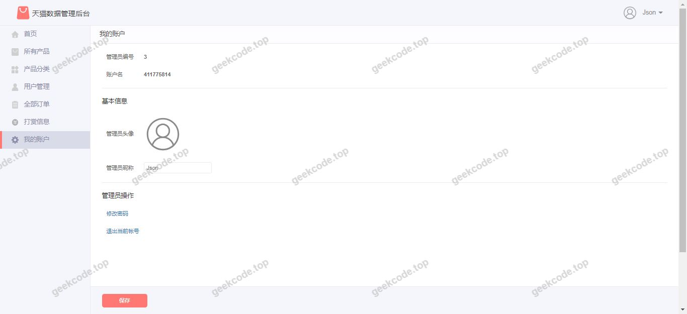

# java精品项目-基于ssm仿天猫精美流网上电子商城项目

> 🎓 **计算机毕业设计 · java精品项目-基于ssm仿天猫精美流网上电子商城项目**
>
> 本仓库只放**项目介绍 + 运行截图**（截图是站点带水印的原图，存在仓库 `images/` 里）。
>
> 👉 **完整可运行源码 / 数据库脚本 / 部署文档：[点我获取](https://geekcode.top/archives/java%E7%B2%BE%E5%93%81%E9%A1%B9%E7%9B%AE-%E5%9F%BA%E4%BA%8Essm%E4%BB%BF%E5%A4%A9%E7%8C%AB%E7%B2%BE%E7%BE%8E%E6%B5%81%E7%BD%91%E4%B8%8A%E7%94%B5%E5%AD%90%E5%95%86%E5%9F%8E%E9%A1%B9%E7%9B%AE?utm_source=github)**
>
> 💬 咨询微信：**ir9372**　|　🌐 更多项目：[极客代码 geekcode.top](https://geekcode.top/?utm_source=github)
>
> 📌 项目详情页：<https://geekcode.top/archives/java%E7%B2%BE%E5%93%81%E9%A1%B9%E7%9B%AE-%E5%9F%BA%E4%BA%8Essm%E4%BB%BF%E5%A4%A9%E7%8C%AB%E7%B2%BE%E7%BE%8E%E6%B5%81%E7%BD%91%E4%B8%8A%E7%94%B5%E5%AD%90%E5%95%86%E5%9F%8E%E9%A1%B9%E7%9B%AE?utm_source=github>

<table><td width="230" align="center"> <b>扫码加微信 ir9372</b></td><td valign="middle">📦 源码 = 项目介绍 + 全部运行截图 + 数据库 + 部署文档 👉 点上方任意截图，直接跳到 <b>极客代码 geekcode.top</b> 详情页</td></table>

---

<h1>java精品项目-基于ssm仿天猫精美流网上电子商城项目</h1>
<h2>项目概述</h2>

本项目名为“java精品项目-基于ssm仿天猫精美流网上电子商城项目”，旨在构建一个模拟天猫风格的网上电子商城系统。项目采用经典的 SSM（Spring + Spring MVC + MyBatis）架构思想，结合 Spring Boot 框架进行快速开发与部署，前端视图层使用 JSP 技术实现。尽管项目名称中包含“前台”与“后台”的概念，但根据提供的路由配置信息，当前版本主要聚焦于核心业务逻辑的实现与界面展示，未配置具体的复杂导航菜单或独立的路由权限体系。该系统适用于计算机专业毕业设计场景，用于演示 Java Web 开发中数据持久化、页面渲染及依赖管理的标准流程。核心目标是通过模仿知名电商平台的界面风格，实现基础的商品展示与交互功能，为学习者提供一套完整的基于 Java 生态的电商原型系统。

<h2>技术架构</h2>

本项目的技术架构遵循分层设计原则，确保代码的高内聚低耦合。

<strong>1. 后端架构</strong>

<ul>
<li><strong>核心框架</strong>：采用 Spring Boot 作为应用容器和自动配置框架，简化了传统 SSM 繁琐的配置过程。</li>
<li><strong>Web 层</strong>：使用 <code>spring-boot-starter-web</code> 处理 HTTP 请求与响应，集成 <code>tomcat-embed-jasper</code> 以支持 JSP 页面的编译与渲染。</li>
<li><strong>持久层</strong>：基于 MyBatis (<code>mybatis-spring-boot-starter</code>) 实现对象关系映射，通过 XML 或注解方式定义 SQL 语句，操作 MySQL 数据库。</li>
<li><strong>数据库连接池</strong>：选用 Druid 作为数据库连接池，不仅提供高效的连接管理，还具备强大的监控功能。</li>
</ul>

<strong>2. 前端架构</strong>

<ul>
<li><strong>视图技术</strong>：使用 JSP (Java Server Pages) 作为服务器端页面生成技术，配合 <code>jstl</code> 标签库简化页面逻辑判断与循环输出。</li>
<li><strong>辅助工具</strong>：引入 <code>taglibs-standard-impl</code> 支持标准标签库，确保页面元素的标准解析。</li>
</ul>

<strong>3. 数据处理与序列化</strong>

<ul>
<li><strong>JSON 处理</strong>：使用 <code>fastjson</code> 进行 Java 对象与 JSON 字符串之间的高效转换，常用于前后端数据交互或日志记录。</li>
<li><strong>数据库驱动</strong>：依赖 <code>mysql-connector-java</code> 实现与 MySQL 数据库的底层通信。</li>
</ul>

<strong>4. 架构图示</strong>

<h2>功能模块</h2>

根据现有的代码上下文、截图列表及路由配置信息，本项目的功能模块主要集中在系统界面的展示与基础运行环境的验证上。由于明确标注“是否有前台: 否”、“是否有后台: 否”且无具体路由定义，以下模块描述严格基于可见的运行界面截图与技术依赖推导出的基础能力：

<strong>1. 系统展示模块</strong>

<ul>
<li><strong>首页/主界面渲染</strong>：对应截图“系统运行界面1”至“系统运行界面8”。该模块负责加载并显示仿天猫风格的静态或动态内容。利用 JSP 和 JSTL 标签库，从后端获取数据并渲染 HTML 结构，呈现商品列表、Banner 图或其他视觉元素。</li>
<li><strong>页面跳转与交互</strong>：虽然无显式路由菜单，但截图展示了多个不同状态的界面，暗示系统具备基础的页面切换能力，可能通过表单提交或链接点击触发 Controller 方法，返回不同的 View Name。</li>
</ul>

<strong>2. 数据访问模块</strong>

<ul>
<li><strong>数据库连接管理</strong>：通过 Druid 连接池建立与 MySQL 的稳定连接，执行基本的 CRUD（增删改查）操作。</li>
<li><strong>ORM 映射</strong>：MyBatis 将数据库中的实体表映射为 Java 对象，供业务层调用。</li>
</ul>

<strong>3. 基础服务模块</strong>

<ul>
<li><strong>Web 请求处理</strong>：Spring Boot Starter Web 接收来自浏览器的 GET/POST 请求，分发至相应的处理逻辑。</li>
<li><strong>数据序列化</strong>：FastJSON 在需要时处理数据格式转换，例如在 AJAX 交互或内部组件间传递结构化数据。</li>
</ul>

<em>注：根据现有信息无法确定具体的“用户注册”、“购物车添加”、“订单支付”等详细业务功能是否已完整实现并暴露给用户，仅能确认系统具备上述基础架构支撑能力。</em>

<h2>用户角色与权限</h2>

根据项目配置信息，“是否有前台: 否”、“是否有后台: 否”以及“无后台路由”、“无前台路由”的描述表明，当前版本的项目文档中未定义复杂的角色权限体系。

<strong>1. 访客角色 (Guest)</strong>

<ul>
<li><strong>权限范围</strong>：所有截图所示的界面（系统运行界面1-8）均可被未登录用户访问。</li>
<li><strong>可执行操作</strong>：浏览网页内容、查看图片、点击页面上的可见链接或按钮（如果存在）。</li>
<li><strong>限制</strong>：无法确定是否存在需要登录才能执行的操作（如购买、评论等），因为缺乏对应的功能模块描述。</li>
</ul>

<strong>2. 管理员角色 (Admin)</strong>

<ul>
<li><strong>状态</strong>：<strong>不存在</strong>。</li>
<li><strong>依据</strong>：项目中明确标记“是否有后台: 否”，且无任何后台管理路由或菜单配置。因此，系统不包含独立的后台管理界面，也不具备管理员登录、数据维护、用户管理等权限功能。</li>
</ul>

<strong>3. 普通注册用户 (User)</strong>

<ul>
<li><strong>状态</strong>：<strong>未明确</strong>。</li>
<li><strong>依据</strong>：虽然这是一个电商项目，通常会有用户角色，但鉴于“是否有前台: 否”且无个人中心菜单，当前交付物中未包含用户登录、注册或个人中心的功能入口。因此，无法列出普通用户的具体权限模块。</li>
</ul>

<strong>总结</strong>：在当前提供的上下文范围内，系统表现为一个<strong>公开的、无需身份验证即可访问的展示型网站原型</strong>。所有访问者均视为同等权限的访客，没有区分管理员与普通用户的权限控制机制。

<h2>项目特色与创新点</h2>

<strong>1. 经典 SSM 架构的现代化改造</strong>
项目保留了 SSM（Spring, Spring MVC, MyBatis）的经典分层理念，但通过 Spring Boot 实现了自动化配置。这种组合既让开发者理解传统 Java Web 的分层逻辑，又享受了现代框架的开发效率，适合教学与毕设演示。

<strong>2. 轻量级全栈整合</strong>
摒弃了重型的前端框架（如 Vue/React）和复杂的微服务治理，选择 JSP + Spring Boot + MyBatis 的组合。这种技术栈对于初学者而言门槛较低，调试直观，能够清晰地看到从 Controller 到 DAO 再到 Database 的数据流向。

<strong>3. 高性能连接池应用</strong>
引入 Druid 作为数据库连接池，相比默认的 HikariCP 或 DBCP，Druid 提供了更丰富的监控指标（如 SQL 执行时间、慢查询统计）。虽然在简单项目中优势不明显，但这体现了对生产环境性能监控意识的早期实践。

<strong>4. 仿主流电商 UI 风格</strong>
项目定位为“仿天猫精美流”，意味着其核心价值之一在于视觉还原度。通过 JSP 模板引擎复刻知名电商平台的布局，锻炼了开发者对 HTML/CSS 结构的掌控能力以及后端数据向前端视图绑定的能力。

<h2>部署环境</h2>

为了确保“java精品项目-基于ssm仿天猫精美流网上电子商城项目”能够正常运行，需准备以下软硬件环境：

<strong>1. 硬件要求</strong>

<ul>
<li>CPU：双核及以上处理器。</li>
<li>内存：建议 4GB 以上 RAM（JVM 运行及数据库缓存需要）。</li>
<li>硬盘：至少 500MB 可用空间用于存放代码包、JAR 依赖及数据库文件。</li>
</ul>

<strong>2. 软件环境</strong>

<ul>
<li><strong>JDK</strong>：Java Development Kit 1.8 或更高版本（推荐 JDK 8，兼容性好；若使用较新 Spring Boot 版本可能需要 JDK 11+，但考虑到 JSP 和老式依赖，JDK 8 是最稳妥的选择）。</li>
<li><strong>Maven</strong>：Apache Maven 3.6+，用于项目依赖管理和打包构建。</li>
<li><strong>数据库</strong>：MySQL 5.7 或 MySQL 8.0 Community Edition。需创建对应的数据库实例并导入初始表结构（如有）。</li>
<li><strong>IDE</strong>：IntelliJ IDEA 或 Eclipse（安装 Spring Boot 插件及 Tomcat 服务器支持）。</li>
<li><strong>Web 服务器</strong>：内置 Tomcat（由 <code>spring-boot-starter-web</code> 和 <code>tomcat-embed-jasper</code> 提供，无需单独安装外部 Tomcat）。</li>
<li><strong>浏览器</strong>：Chrome、Firefox 或 Edge 等现代浏览器，用于访问 JSP 页面。</li>
</ul>

<strong>3. 关键配置文件检查</strong>

<ul>
<li><code>application.properties</code> 或 <code>application.yml</code>：需正确配置 <code>spring.datasource.url</code>、<code>username</code>、<code>password</code> 指向本地 MySQL 地址。</li>
<li><code>pom.xml</code>：确保包含 <code>mysql-connector-java</code>, <code>druid</code>, <code>mybatis-spring-boot-starter</code>, <code>spring-boot-starter-web</code>, <code>tomcat-embed-jasper</code>, <code>jstl</code> 等依赖项。</li>
</ul>
<h2>五、技术特性</h2>
<ul>
<li>服务端模板渲染（JSP）</li>
</ul>
<h2>六、功能模块截图</h2>
<h3>前台用户端</h3>
<h4>系统运行界面1</h4>

<h4>系统运行界面2</h4>

<h4>系统运行界面3</h4>

<h4>系统运行界面4</h4>

<h4>系统运行界面5</h4>

<h4>系统运行界面6</h4>

<h4>系统运行界面7</h4>

<h4>系统运行界面8</h4>

---

## 获取完整源码

| 项目 | 说明 |
| --- | --- |
| 项目名 | java精品项目-基于ssm仿天猫精美流网上电子商城项目 |
| 运行截图 | 本文 9 张（站点带水印原图，仓库 `images/` 目录） |
| 完整源码 | [https://geekcode.top/archives/java%E7%B2%BE%E5%93%81%E9%A1%B9%E7%9B%AE-%E5%9F%BA%E4%BA%8Essm%E4%BB%BF%E5%A4%A9%E7%8C%AB%E7%B2%BE%E7%BE%8E%E6%B5%81%E7%BD%91%E4%B8%8A%E7%94%B5%E5%AD%90%E5%95%86%E5%9F%8E%E9%A1%B9%E7%9B%AE?utm_source=github](https://geekcode.top/archives/java%E7%B2%BE%E5%93%81%E9%A1%B9%E7%9B%AE-%E5%9F%BA%E4%BA%8Essm%E4%BB%BF%E5%A4%A9%E7%8C%AB%E7%B2%BE%E7%BE%8E%E6%B5%81%E7%BD%91%E4%B8%8A%E7%94%B5%E5%AD%90%E5%95%86%E5%9F%8E%E9%A1%B9%E7%9B%AE?utm_source=github) |
| 咨询微信 | **ir9372**（备注：jingpin-yuanma） |
| 更多项目 | [极客代码 geekcode.top](https://geekcode.top/?utm_source=github) |

> 需要源码、部署、改配置、跑不起来等问题，加微信 ir9372 沟通，说明项目名即可。
